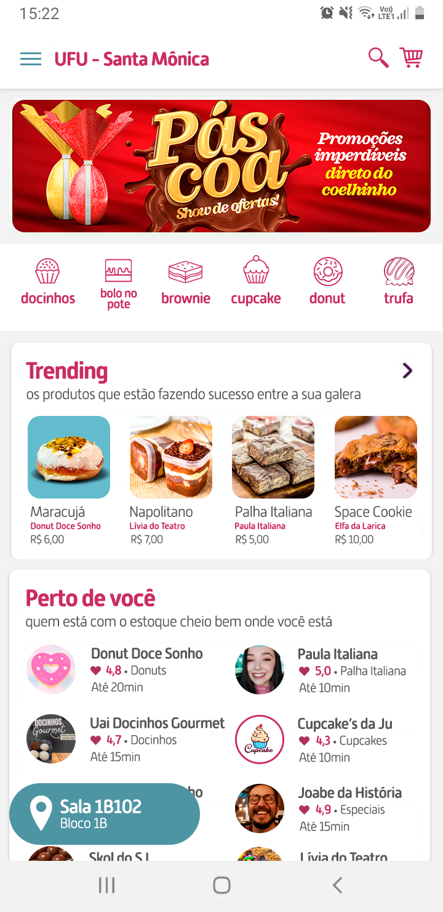
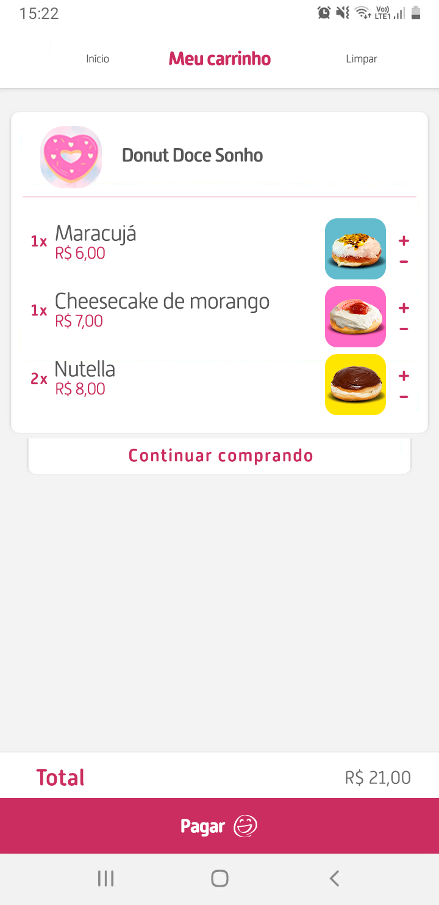
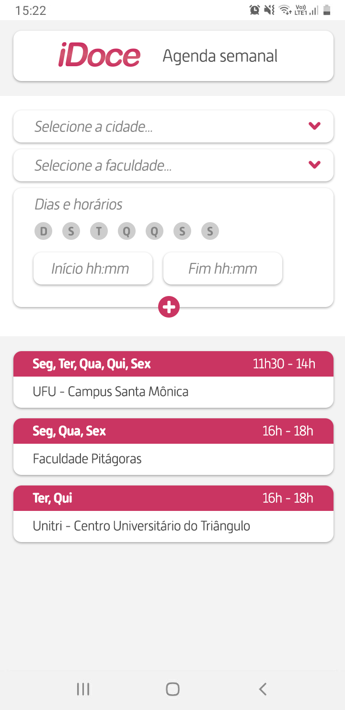
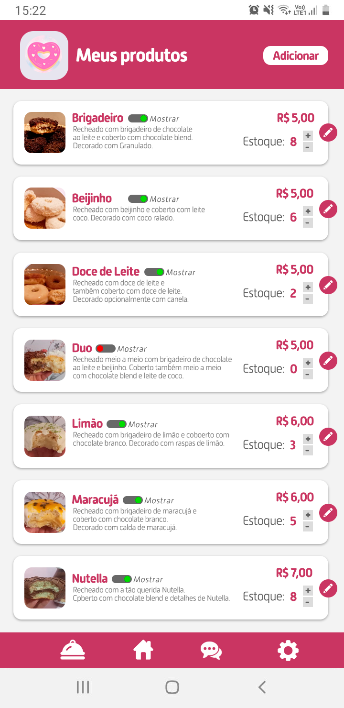
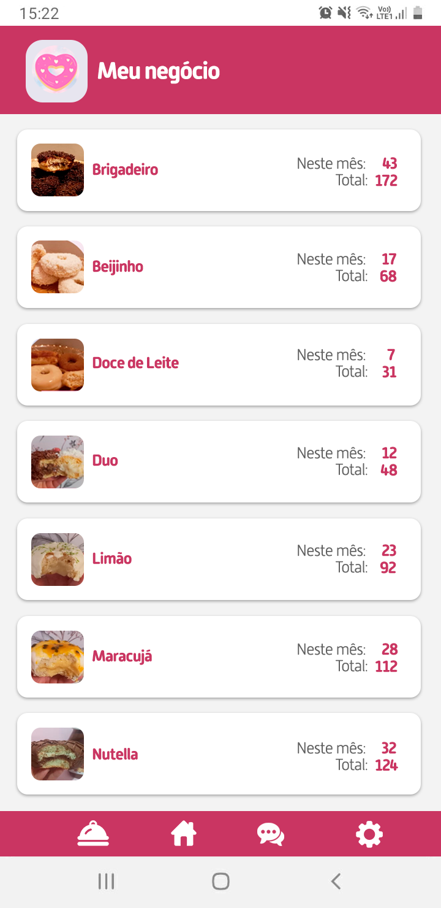
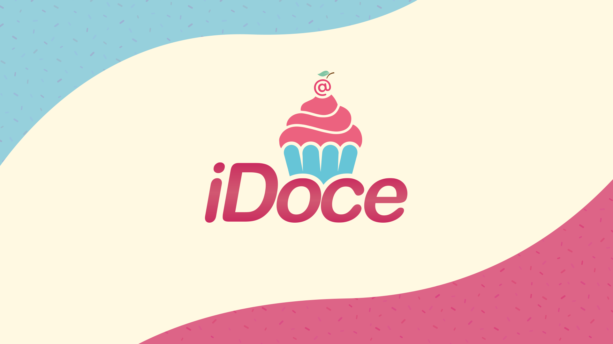

# iDoce: delivery de doces artesanais feitos por estudantes

Plano de negócios e protótipo de telas de um aplicativo que conecta estudantes que vendem doces artesanais (para ajudar a pagar moradia e estudos) a colegas que querem comprar no campus.

## Sobre o projeto

A ideia era uma plataforma com dois aplicativos:

- **app do cliente**: vitrine com promoções, "trending" e vendedores próximos, carrinho e pagamento;
- **app do vendedor (parceiro)**: agenda semanal de pontos de venda (por campus e faculdade), pedidos recebidos, cadastro de produtos com estoque e painel "Meu negócio" com vendas do mês.

O plano de negócios (`Plano de negócios - idoce.pdf`) traz sumário executivo, matriz SWOT, plano de marketing, análise de clientes (com pesquisa entre estudantes) e de concorrentes e plano financeiro. No plano, eu era o responsável por marketing; também desenhei a identidade visual e as telas do protótipo.

## Telas

| Início (cliente) | Carrinho | Agenda do vendedor | Meus produtos | Meu negócio |
|---|---|---|---|---|
|  |  |  |  |  |

## Ferramentas

Adobe Photoshop e Illustrator (telas e logo), Microsoft Word (plano de negócios). Não houve implementação em código: o trabalho era o plano de negócios e o protótipo visual.

## Contexto acadêmico

- Disciplina: Empreendedorismo em Informática (GSI001), Bacharelado em Sistemas de Informação, FACOM/UFU
- Semestre: 2022-1 (entrega em jan/2023)
- Trabalho em grupo com Douglas Stuhler Pinheiro, Kaique Siqueira de Sousa Oliveira e Vinícius Lucas Guimarães, além de Carlos Eduardo da Silva Pechiori (Cadu)

## O que foi ajustado em 2026

- Selecionei 5 das 8 telas (as outras mostram fotos de colegas como usuários fictícios) e reduzi o logo para 1280 px de largura. Os arquivos de design (.psd/.ai) não foram publicados.
