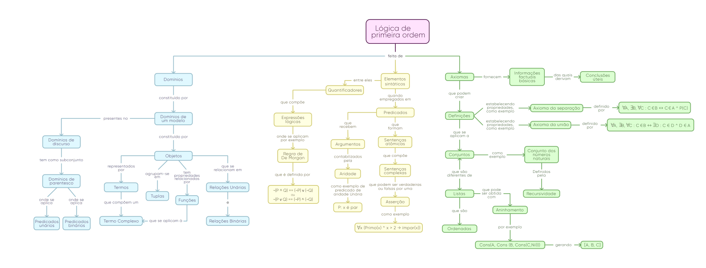

# Programação Lógica (Prolog)

Trabalhos em grupo da disciplina de Programação Lógica: um mapa conceitual de lógica de primeira ordem e dois exercícios em Prolog, apresentados em vídeo.

## Sobre

- **`mapa-conceitual/`** (Trabalho 1): mapa conceitual de lógica de primeira ordem (domínios, elementos sintáticos, quantificadores, predicados, axiomas, conjuntos e listas). Eu fiz a diagramação do mapa e da apresentação.
- **`Corte.pl`**: árvore genealógica com fatos (`pai/2`, `mae/2`, `masculino/1`, `feminino/1`) e regras que usam o **corte** (`!`) para parar a busca na primeira solução, com comentários explicando o efeito de cada corte.
- **`tabelas.pl`**: "tabelas" de funcionários e dependentes como fatos; regra `listar_dependentes/1` com `findall/3` e consultas com `forall/2` (faixa salarial, de quem uma pessoa é dependente).



## Vídeos do grupo

Os exercícios foram apresentados em vídeo (eu editei os vídeos):

- Mecanismo de corte: https://youtu.be/OJdv_YJvXC4
- Tabelas: https://youtu.be/9QZuTTzNgVY

## Como executar

Com SWI-Prolog:

```
swipl tabelas.pl
?- listar_dependentes(andrew).
?- forall((funcionario(_, Nome, Salario), Salario >= 2000, Salario =< 4500), writeln([Nome, Salario])).

swipl Corte.pl
?- homem(X).
?- homens(X, Y).
```

Não reexecutei os arquivos nesta revisão (SWI-Prolog não está instalado nesta máquina).

## Contexto acadêmico

- Disciplina: Programação Lógica (GSI010), Bacharelado em Sistemas de Informação, FACOM/UFU
- Semestre: 2022-2
- Grupo 7: Anna Clara Rodrigues Peres, Douglas Stuhler Pinheiro, Isabella Paula Simão, Paula Prado Carvalho e Vinícius Lucas Guimarães, além de Carlos Eduardo da Silva Pechiori (Cadu)

## O que foi ajustado em 2026

- Arquivos `.pl` convertidos de Latin-1 para UTF-8.
- Ficaram de fora rascunhos (versões anteriores dos mesmos arquivos) e exercícios de outros grupos. Os vídeos não estão no repositório; os links acima são os publicados pelo grupo.
