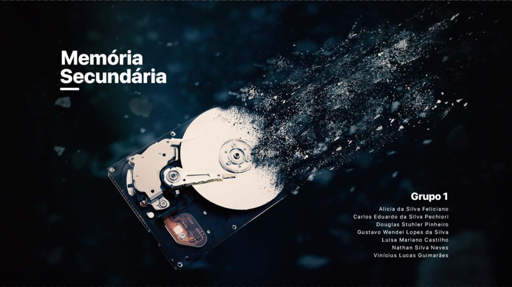

# Arquitetura e Organização de Computadores

Seminário sobre memória secundária (dispositivos de armazenamento e RAID).

## Sobre

### Seminário: Memória secundária (Grupo 1)

`apresentacao-memoria-secundaria.pdf` (36 slides): história, funcionamento, técnicas, vantagens e desvantagens de discos magnéticos, disquetes, discos IDE, discos SCSI e RAID (níveis 0, 1, 5, 6 e combinações). Eu fiz o design dos slides.

## Contexto acadêmico

- Disciplina: Arquitetura e Organização de Computadores (GSI013), Bacharelado em Sistemas de Informação, FACOM/UFU
- Semestre: 2023-1
- Seminário em grupo (Grupo 1) com Alicia da Silva Feliciano, Douglas Stuhler Pinheiro, Gustavo Wendel Lopes da Silva, Luisa Mariano Castilho, Nathan Silva Neves e Vinícius Lucas Guimarães, além de Carlos Eduardo da Silva Pechiori (Cadu)
- Depois da disciplina, fui monitor de AOC no programa de tutoria do PET-SI e gravei videoaulas de AOC para colegas.
