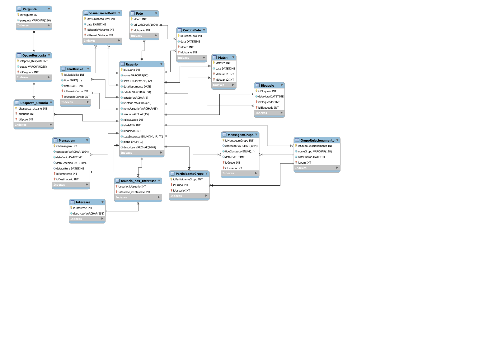
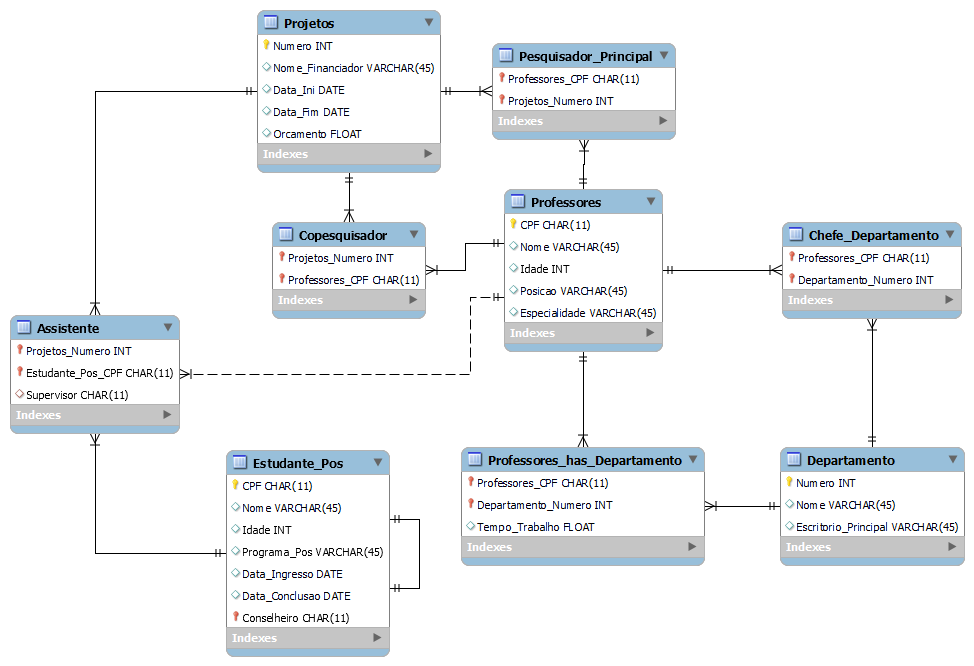

# Banco de Dados 1

Modelagem relacional no MySQL Workbench e consultas SQL em PostgreSQL.

## Sobre

| Pasta | Período | Conteúdo |
|---|---|---|
| `trabalho-1/` | 2023-2 | Modelo relacional de um sistema de projetos de pesquisa (professores, projetos, estudantes de pós-graduação e departamentos), com relacionamentos 1:n e n:n, pesquisador principal, copesquisadores, assistentes, orientador e chefe de departamento. Inclui o modelo (`Trabalho1.mwb`), o diagrama (`Trabalho1.png`) e o relatório com as entidades e relações auxiliares. |
| `lista-2-sql/` | 2023-2 | 10 consultas (filtros com `LIKE`, intervalos de datas, `UNION`, `INTERVAL`, `LIMIT`, agregações) sobre o banco "locadora" usado em aula. |
| `consultas-locadora/` | 2024-1 | 14 consultas mais avançadas sobre o mesmo banco: subconsultas aninhadas, `EXISTS`, subconsultas correlacionadas no `SELECT`, `GROUP BY` e autorrelacionamento (cliente que indicou outro cliente). PDF original e o SQL extraído em `consultas-locadora.sql`. |
| `projeto-finder/` | 2024-1 | **Finder**: modelo de dados de um aplicativo de relacionamentos com 16 tabelas: usuário, fotos e curtidas, interesses, perguntas e respostas de perfil, visualizações, like/dislike, match, mensagens, grupos com participantes e mensagens de grupo, e bloqueios. |

O esquema e os dados do banco "locadora" foram fornecidos pelo professor e não estão no repositório; as consultas usam as tabelas `filme`, `ator`, `estrela`, `cliente`, `emprestimo`, `midia` e `classificacao`.

## Tecnologias

MySQL Workbench (modelagem), PostgreSQL (consultas), SQL.

## Como usar

- Abrir os arquivos `.mwb` no MySQL Workbench (File > Open Model).
- As consultas rodam em um PostgreSQL com o esquema `locadora` carregado (`SET search_path TO locadora;`). Não reexecutei as consultas nesta revisão, porque o banco da disciplina não faz parte do repositório.

## Contexto acadêmico

- Disciplina: Banco de Dados 1 (GSI016), Bacharelado em Sistemas de Informação, FACOM/UFU
- Materiais de 2023-2 (trabalho 1 e lista 2) e de 2024-1 (consultas e projeto Finder). Trabalhos individuais.

## O que foi ajustado em 2026

- Número de matrícula removido do cabeçalho de `lista2.sql` e do PDF de consultas antes de publicar.
- As 14 consultas do PDF foram extraídas para `consultas-locadora/consultas-locadora.sql`.
- `docs/finder-diagrama.png` foi renderizado a partir do PDF do modelo.
