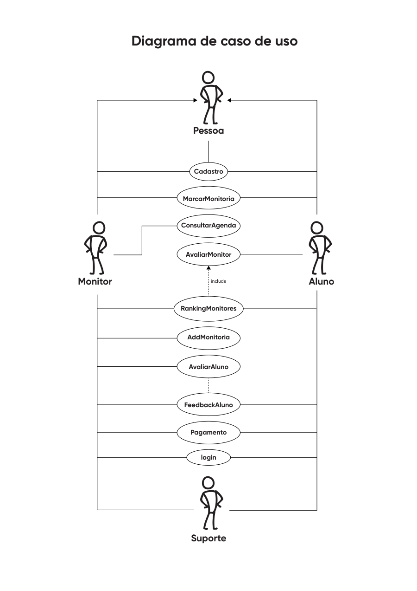
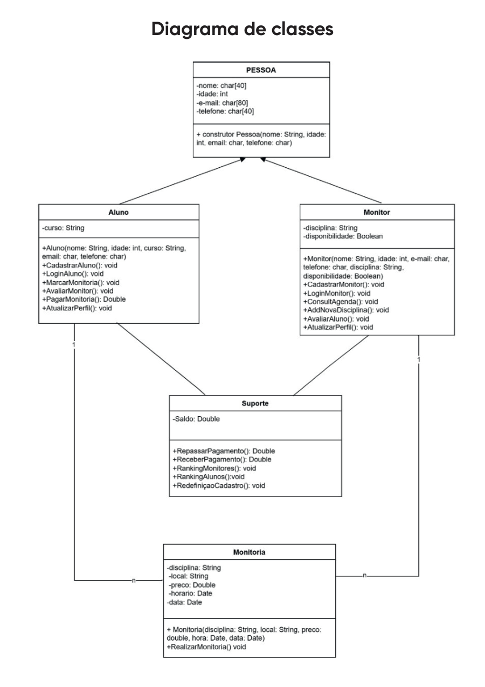
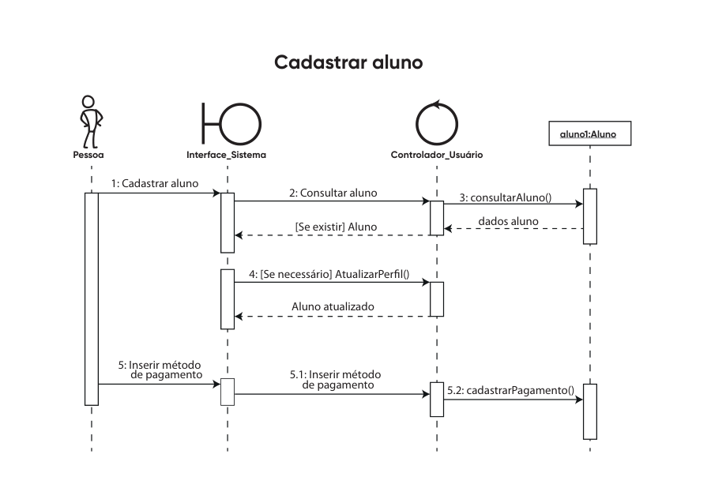

# TutorMatch: modelagem de um app de monitorias

Documento de requisitos e modelagem UML de um aplicativo para estudantes da UFU buscarem ou oferecerem monitorias particulares, inspirado no modelo do BlaBlaCar.

## Sobre o projeto

No TutorMatch, a mesma conta pode atuar como aluno ou como monitor. O aluno busca monitorias por disciplina, local, horário, formato (presencial ou online) e preço; o monitor publica ofertas com disponibilidade e valor por hora; o agendamento gera notificações de confirmação, o pagamento passa pelo app e, depois de cada sessão, aluno e monitor avaliam um ao outro; as avaliações alimentam um ranking de monitores.

O documento (`Modelagem de software - Tutor Match.pdf`, 12 páginas) contém:

- requisitos funcionais, de interface, de qualidade (segurança, desempenho, confiabilidade), restrições e características dos usuários;
- diagrama de fluxo de dados (nível 0) e diagrama de contexto;
- diagrama de casos de uso (atores Aluno, Monitor, Suporte e a generalização Pessoa);
- diagrama de classes, diagrama de comunicação e diagramas de sequência (cadastrar aluno, cadastrar monitor, marcar monitoria).

| Casos de uso | Classes | Sequência: cadastrar aluno |
|---|---|---|
|  |  |  |

## Ferramentas

UML (casos de uso, classes, comunicação e sequência), DFD; documento diagramado no Adobe Illustrator.

## Contexto acadêmico

- Disciplina: Modelagem de Software (GSI025), Bacharelado em Sistemas de Informação, FACOM/UFU
- Semestre: 2023-2 (entrega em abr/2024)
- Trabalho em grupo com Luis Gustavo Marinho Machado, Rodrigo de Oliveira Rodrigues e Luiz Felipe da Silva Pereira, além de Carlos Eduardo da Silva Pechiori (Cadu)

## O que foi ajustado em 2026

- Os números de matrícula da capa e da contracapa foram removidos do PDF antes de publicar.
- As imagens em `docs/` foram renderizadas a partir do próprio PDF.
