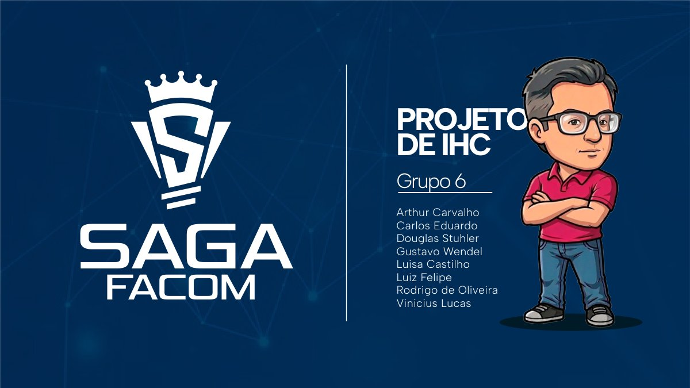

# SAGA FACOM: onboarding gamificado para estudantes de computação

Projeto de Interação Humano-Computador: um app que transforma a jornada acadêmica em um jogo, com missões, desafios e recompensas, para engajar os estudantes e combater a evasão nos cursos da FACOM.

## Sobre o projeto

O grupo partiu da pergunta "qual o maior problema enfrentado hoje por nossos colegas?" e chegou à alta evasão nos cursos de computação. O projeto passou pelas três fases do processo de design centrado no usuário:

1. **Entendimento**: personas (calouro entusiasmado, aluno desgastado no meio do curso, técnico-administrativo da coordenação) e cenários de uso, como a "missão do dia" (cinco perguntas rápidas sobre Algoritmos 2) e o "desafio da torre de AOC" (cinco andares de perguntas).
2. **Design e prototipação**: ideação no FigJam, mecânicas de jogo, fluxos de navegação, identidade visual (personagens, itens, ícones, paleta) e protótipo navegável com missão diária, desafio difícil, sistema de recompensas e inventário.
3. **Teste de usabilidade**: testes pelo método de coaching, que mostraram, por exemplo, que o botão "missão do dia" parecia um aviso, que as alternativas deveriam ser os próprios botões e que as fontes precisavam ser maiores.

Nesta pasta:

- `Slides apresentação.pdf`: apresentação final (26 slides);
- `Logo-personas-caso de uso.pdf`: logo, as três personas e dois cenários de uso;
- `SAGA FACOM.png`: tela principal do protótipo.

Minha participação incluiu a identidade visual, as ilustrações e o design das peças e dos slides.

## Ferramentas

FigJam (ideação e fluxos), Adobe Illustrator e Photoshop (identidade visual, ilustrações e slides).

## Contexto acadêmico

- Disciplina: Interação Humano-Computador (GSI037), Bacharelado em Sistemas de Informação, FACOM/UFU
- Semestre: 2025-2 (apresentação em mar/2026)
- Grupo 6: Arthur Carvalho, Douglas Stuhler, Gustavo Wendel, Luisa Castilho, Luiz Felipe, Rodrigo de Oliveira e Vinicius Lucas, além de Carlos Eduardo da Silva Pechiori (Cadu)

## O que foi ajustado em 2026

- Removida a página de dedicatória dos slides, que citava colegas pelo nome.
- As fotos usadas como retrato das personas foram cobertas (imagens de terceiros, sem licença clara).
- As imagens dos PDFs foram recomprimidas para reduzir o tamanho.
- Não foram publicados o projeto Unity, os arquivos de design (.ai/.psd), as fontes nem os assets de terceiros.
