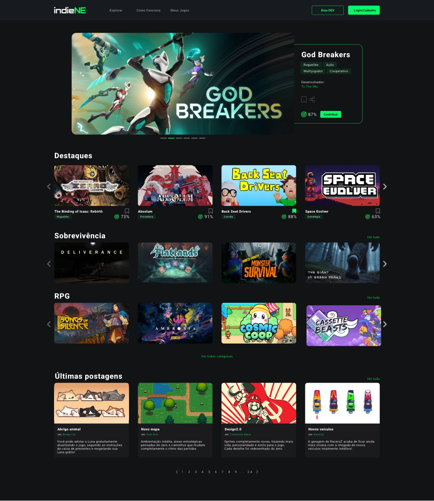
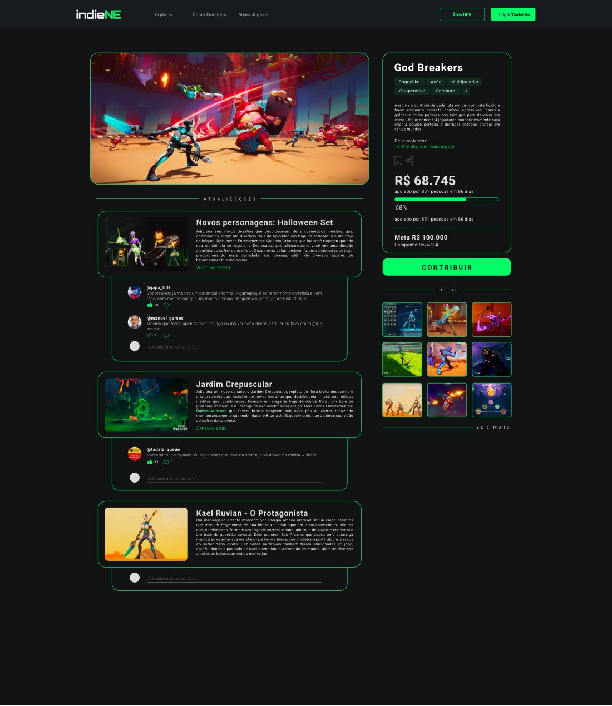
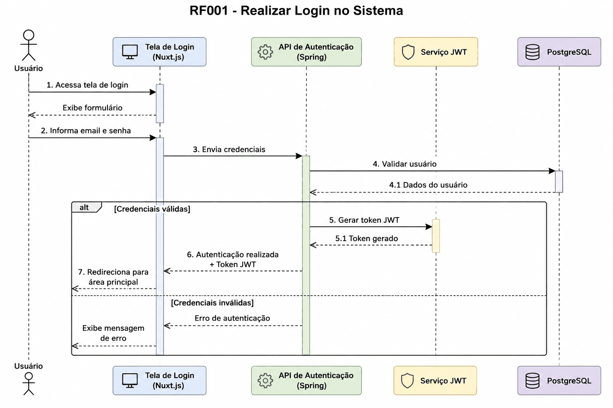

# IndieNE: plataforma de jogos indie com financiamento coletivo

Projeto de PDSI 1 e 2: uma plataforma web onde desenvolvedores independentes publicam seus jogos, mostram o progresso e recebem apoio financeiro da comunidade. **Minha parte foi o design de UI/UX**; o código foi feito pelos colegas.

## Sobre o projeto

A plataforma reúne catálogo de jogos e projetos, área do desenvolvedor (publicação e gestão de projetos), postagens de atualização com comentários e interações da comunidade, perfis de usuário e campanhas de financiamento coletivo com meta e progresso.

Nesta pasta:

- `ui/UI indieNE.pdf`: as telas que desenhei (início com destaques por gênero, catálogo com filtros, página do jogo com campanha e atualizações, explicação do financiamento coletivo e área do desenvolvedor);
- `diagramas-de-sequencia/`: 11 diagramas de sequência dos requisitos RF001–RF011 (login, perfil de usuário, gestão de projetos, doações para projetos, postagens e interações, imagens, publicação de atualizações, comentários, visualização de perfil e desabilitação de usuário), feitos pelo grupo em PDSI 2.

| Início | Página do jogo |
|---|---|
|  |  |

As capas de jogos usadas nas telas são apenas ilustrativas e pertencem aos respectivos estúdios.

## Código

Repositório do grupo: https://github.com/giulianomaradei/IndieNE

Stack do sistema: Nuxt (Vue 3) no front-end, Spring Boot 3 no back-end, PostgreSQL e autenticação com JWT.

## Ferramentas (minha parte)

Adobe Illustrator e Photoshop para as telas e a identidade visual.

## Contexto acadêmico

- Disciplinas: Projeto e Desenvolvimento de Sistemas de Informação 1 e 2 (GSI034), Bacharelado em Sistemas de Informação, FACOM/UFU
- Semestres: 2025-2 (PDSI 1, telas) e 2026-1 (PDSI 2, diagramas)
- Trabalho em grupo com Giuliano Maradei Carneiro Zacharias, Gustavo Wendel Lopes da Silva, Mateus Granjeia Nogueira, Rafael Lopes Fraga, Vinícius Lucas Guimarães, Vitor de Carvalho Silva, Vitor Gabriel Oliveira, Douglas de Souza Nascimento Santos e Enzo Baraldi de Onofre, além de Carlos Eduardo da Silva Pechiori (Cadu)

## O que foi ajustado em 2026

- Os diagramas foram recomprimidos (paleta de 128 cores) para reduzir o tamanho, sem mudar o conteúdo.
- As prévias em `docs/` foram renderizadas a partir do PDF das telas.
