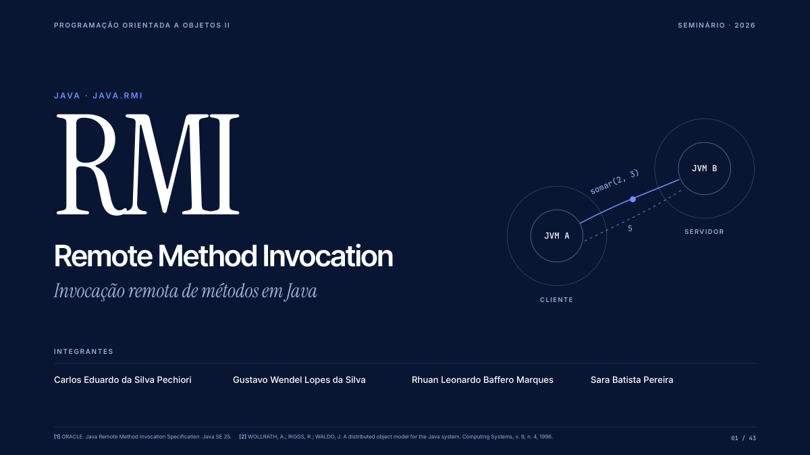

# Seminário: Java RMI (Remote Method Invocation)

Slides de um seminário de cerca de 70 minutos sobre invocação remota de métodos em Java, apresentado na disciplina de Programação Orientada a Objetos 2.

## Sobre

`RMI_Apresentacao.pdf` (43 slides) segue o roteiro definido pela disciplina, com uma analogia de restaurante do começo ao fim:

1. Revisão rápida de POO;
2. Introdução à invocação remota de métodos: "e se o objeto que você quer usar estiver em outro computador?";
3. Conceitos básicos: interface remota, objeto remoto, stub e skeleton, serialização;
4. Camadas do RMI;
5. Serviços de registro e de nomes (`rmiregistry`, `Naming`/`Registry`);
6. Aplicações de RMI e o que mudou até hoje.

Cada slide traz no rodapé as fontes do conteúdo (especificação da Oracle, artigos e livros), reunidas em três páginas de referências.

## Contexto acadêmico

- Disciplina: Programação Orientada a Objetos 2, Bacharelado em Sistemas de Informação, FACOM/UFU
- Semestre: 2026-2
- Seminário em grupo com Gustavo Wendel Lopes da Silva, Rhuan Leonardo Baffero Marques e Sara Batista Pereira, além de Carlos Eduardo da Silva Pechiori (Cadu)

## O que foi ajustado em 2026

- Números de matrícula removidos da capa antes de publicar.
